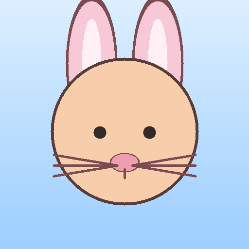
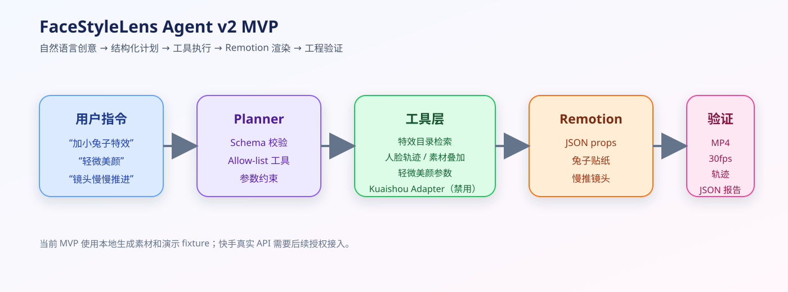

# FaceStyleLens Agent v2

> 面向短视频创意的多模态特效编排 Agent：把“加一个小兔子特效，轻微美颜，镜头慢慢推进”转换成可审计的工具计划，并使用 Remotion 生成视频。

## 演示

[下载演示视频 demo.mp4](docs/assets/demo.mp4)

演示视频由本地生成素材和 Remotion 生成，输出为 512×512、30fps、约 5 秒的 H.264 MP4。

## 项目背景

用户说“来一个小兔子特效”“自然一点地美颜”“镜头慢慢推进”时，系统需要先理解创意，再把它拆成特效检索、人脸定位、素材叠加、美颜参数、时间线和渲染检查。

FaceStyleLens Agent v2 的最小版本先验证这条工程链路：

    自然语言创意
        ↓
    结构化计划与参数校验
        ↓
    本地特效目录 / 人脸轨迹 / 美颜工具
        ↓
    Remotion JSON props
        ↓
    视频渲染
        ↓
    可复现的验证报告

## 当前能力

- 解析固定的中文创意指令；
- 生成 allow-list 工具计划；
- 检索本地小兔子素材；
- 生成 fixture-aware 人脸轨迹；
- 叠加兔耳、兔鼻和胡须；
- 添加受限的 natural_skin 美颜参数；
- 用 Remotion 做慢推镜头和视频合成；
- 生成 MP4、PNG、计划、执行轨迹和验证报告；
- 对无脸、多人脸、缺失素材、非法视频等情况返回结构化错误；
- 清理旧输出，避免失败运行残留旧的 result.mp4。

## 快速开始

环境要求：Python 3.10+、Node.js、npm；ffprobe 可选。

检查版本：

    python --version
    node --version
    npm --version

安装 Remotion：

    cd mvp/remotion
    npm install
    cd ../..

运行正常案例：

    python -m mvp --fixture normal_single_face --run-dir mvp/runs/demo

成功时终端会返回：

    {
      "status": "verified",
      "error_code": null
    }

只跑计划和预览：

    python -m mvp --fixture normal_single_face --no-mp4 --run-dir mvp/runs/preview_only

## 输入

| 参数 | 默认值 | 说明 |
| --- | --- | --- |
| --prompt | 加小兔子特效，轻微美颜，镜头慢慢推进。 | 自然语言创意指令 |
| --fixture | normal_single_face | 工程夹具 |
| --run-dir | mvp/runs/demo | 输出目录 |
| --no-mp4 | 关闭 | 跳过 MP4 渲染，只跑计划和预览 |

修改提示词：

    python -m mvp --prompt "加小兔子特效，轻微美颜，镜头慢慢推进" --fixture normal_single_face --run-dir mvp/runs/custom_prompt

当前版本使用项目生成的演示素材，尚未开放 --input 真实视频路径。真实用户视频接入属于后续扩展。

## 工程夹具

| fixture | 含义 | 预期状态 |
| --- | --- | --- |
| normal_single_face | 正常单人脸 | 生成 MP4，verified |
| no_face | 无人脸 | no_face_detected |
| multiple_faces | 多人脸 | multiple_faces |
| unsupported_effect | 目录中不存在的效果 | asset_not_found |
| missing_asset | 计划引用缺失素材 | asset_not_found |
| invalid_video | 非法媒体输入 | invalid_video |

运行失败夹具：

    python -m mvp --fixture no_face --no-mp4
    python -m mvp --fixture multiple_faces --no-mp4
    python -m mvp --fixture unsupported_effect --no-mp4
    python -m mvp --fixture missing_asset --no-mp4
    python -m mvp --fixture invalid_video --no-mp4

这些是预期失败，不代表系统崩溃。失败运行不得留下旧的 result.mp4。

## 输出

运行目录中会生成：

| 文件 | 作用 |
| --- | --- |
| plan.json | 结构化 Agent 工具计划 |
| props.json | Remotion 使用的版本化 JSON props |
| execution_trace.json | 工具选择、参数、错误和验证轨迹 |
| preview.png | 确定性预览图 |
| result.mp4 | Remotion 生成的最终视频 |
| verification.json | 文件、渲染、帧率和时长检查 |
| resolved_provenance.json | 素材 hash、来源和 final-test 访问标记 |

正常输出规格：H.264、512×512、30fps、150 帧、约 5 秒，verification.status 为 verified。

查看报告：

    Get-Content -Raw mvp/runs/demo/verification.json

查看视频元数据：

    ffprobe -v error -show_entries format=duration:stream=codec_name,width,height,r_frame_rate,nb_frames -of json mvp/runs/demo/result.mp4

## 工具契约

Agent 只能调用：

    face_detect_and_track
    search_effect_catalog
    apply_face_asset
    apply_beauty_effect
    compose_timeline
    render_preview
    verify_result

所有参数先经过 JSON 校验。Agent 不能输出或执行任意 TSX、JavaScript、Shell、URL 或原始文件路径。

正常执行顺序：

    face_detect_and_track
    → search_effect_catalog
    → apply_face_asset
    → apply_beauty_effect
    → compose_timeline
    → render_preview
    → verify_result

## 快手平台边界

当前版本使用 LocalEffectCatalog 和项目生成素材。快手真实 provider adapter 尚未创建，也不会读取 app_id、access_token、上传用户视频、调用未确认的接口或编造 effect_id。

后续接入快手需要正式 API 契约、账号权限、素材授权、服务版本和隐私处理方案。

## 测试

Python 单元测试：

    python -m unittest discover -s mvp/tests -p "test_*.py"

Remotion TypeScript 检查：

    cd mvp/remotion
    npx --no-install tsc --noEmit
    cd ../..

建议验收顺序：

1. 运行 Python 单元测试；
2. 运行五类失败夹具；
3. 安装 Remotion 依赖；
4. 运行 normal_single_face；
5. 用 ffprobe 检查 MP4；
6. 查看 verification.json 和 execution_trace.json。

## 项目结构

    .
    ├── README.md
    ├── mvp/
    │   ├── planner.py
    │   ├── schema.py
    │   ├── catalog.py
    │   ├── executor.py
    │   ├── verifier.py
    │   ├── assets/
    │   ├── fixtures/
    │   ├── tests/
    │   ├── remotion/
    │   └── docs/assets/
    ├── DESIGN.md
    ├── TICKETS.md
    └── DESIGN_REVIEW_FACESTYLE_AGENT_V2.md

项目的公开范围和限制已写在本 README 的“当前限制”部分。

## 当前限制

这是工程链路 MVP：

- 规划器是规则约束实现，不是 VLM/LLM；
- 人脸轨迹来自演示 fixture；
- 尚未接入真实用户视频；
- 尚未接入快手真实特效 API；
- 轻微美颜是受限渲染参数，不是训练得到的美颜模型；
- 尚未进行人类语义评测或效果质量对比；
- engineering verified 不等于语义理解正确或效果质量优秀。

## 许可证和素材

项目生成的兔子 SVG 和演示 fixture 用于本地 MVP。Remotion、React、FFmpeg 和其他依赖遵循各自上游许可证。使用真实用户视频或第三方素材时，应先确认肖像、版权和服务条款。